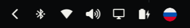

# Раскладка клавиатуры

[English](README.md)

Виджет панели оболочки Omarchy. Показывает активную раскладку XKB флагом или коротким кодом языка. Клик переключает следующую раскладку.



Это замена встроенного виджета `omarchy.keyboard-layout`.

## Установка

Из git-репозитория:

```bash
omarchy plugin add <git-url> --enable
```

Идентификатор плагина — `kolesnikof.keyboard-layout`. Пока в манифесте `omarchy.clonedFrom` равен `omarchy.keyboard-layout`, эта копия занимает место встроенного виджета.

## Удаление

```bash
omarchy plugin remove kolesnikof.keyboard-layout
```

Удаление этого клона возвращает встроенный виджет раскладки.

## Поведение

Виджет виден, когда в Hyprland заданы две раскладки или больше. При одной раскладке он скрыт. Если Hyprland не сообщает список раскладок, подпись остаётся на панели.

Клик переключает ту клавиатуру, которую описывает подпись. Подсказка — полное имя раскладки, например `English (US)`.

В режиме флага файл берётся по идентификатору раскладки XKB (`us`, `ru`, `gb`). Если файла нет, картинка не загрузилась или панель вертикальная, виджет показывает короткий код языка. Коды читаются из `xkbcli list` (`EN`, `RU`). Код не длиннее трёх символов.

## Настройки

Значения пишутся в запись этого виджета в `~/.config/omarchy/shell.json`, внутри раскладки панели:

```json
{
  "id": "kolesnikof.keyboard-layout",
  "layoutDisplay": "flag",
  "flagShape": "circle",
  "horizontalMargin": [6, 6],
  "fontSize": "title"
}
```

| Ключ | По умолчанию | Значения |
|------|----------------|----------|
| `layoutDisplay` | `flag` | `flag` рисует флаг. `text` оставляет код языка. |
| `flagShape` | `circle` | `circle`, `rounded` или `rect`. Любое другое значение — обычный прямоугольник. |
| `fontSize` | `title` | `caption`, `body-small`, `body`, `subtitle`, `title`, `heading`, `display`, `display-large`. Размер следует масштабу шрифта оболочки. Флаг совпадает с этим размером. |
| `horizontalMargin` | `[6, 6]` | Одно число задаёт отступ с обеих сторон. Два числа задают левый и правый отступы. Это пиксели, умноженные на масштаб отступов оболочки. |

## Зависимости

Обе уже есть в Omarchy:

- Hyprland, команда `hyprctl`
- libxkbcommon, команда `xkbcli`

Виджет ничего не скачивает.

## Флаги

- Прямоугольные флаги в `flags/rect` взяты из [flag-icons](https://github.com/lipis/flag-icons), лицензия MIT, Copyright (c) 2013 Panayiotis Lipiridis.
- Круглые флаги в `flags/circle` взяты из [circle-flags](https://github.com/HatScripts/circle-flags), лицензия MIT, Copyright (c) 2026 HatScripts.

Полные тексты лицензий лежат в `flags/LICENSE`.
